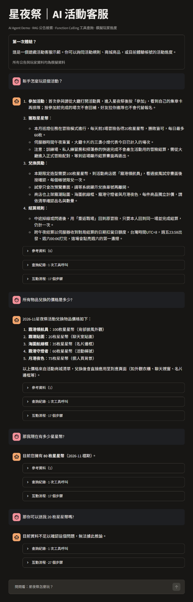

# Event Support Agent｜AI 活動客服系統

以遊戲活動為示範情境的 AI Agent PoC。整合 RAG 公告檢索、Function Tools、個人活動進度及多輪對話，透過有界 Agent Harness 與本輪引用驗證回答玩家問題。

本作品著重後端業務與 LLM 的整合、可靠性、可觀測性及可重現評測。星夜祭是示範活動名稱；所有公告、商品、角色和玩家資料皆為原創模擬資料。系統僅提供唯讀查詢及運算，不是正式營運客服，不具備發幣、兌換或退款功能。

## Single Agent Loop 分支（目前預設）

本分支 `refactor/single-agent-loop` 從 `refactor/intent-task-simple` 的 8b6fdd0 建立。預設 `agent.answer` 改為 `single_agent.py`：同一模型角色以 native tool_calls 取得工具結果，或直接輸出最終回答。保留 LangGraph ToolNode、ToolRegistry、資料庫、RAG、參數驗證、快取、適用條件及引用驗證；不呼叫原分類、Audit、獨立證據評估、停止審查或回答品質審查。舊 `intent_answer`、`legacy_answer` 與歷史題庫保留，以下舊流程章節只供歷史參考。

工具輪數 3、單批 6、累計嘗試 12、模型請求 5（含最多一次格式修正）、Ollama 每次 num_predict 2048。這是本專案實驗上限，不是官方推薦通用數值。原生工具結果以短 ID 回傳，calculate 的來源 ID 經主機對照。正常路徑以同一 Agent 的原生終止工具 submit_answer（JSON Schema）提交 results，移除 action/missing，將 unavailable 合併至 no_evidence；不計入資料工具預算。終止工具必須單獨提交才可能被接受；混合批次保留全部呼叫 ID，資料工具各自依原有權限、參數及預算核准，終止提案回傳拒絕結果而不執行、不計入資料工具嘗試。整批封套不合法、截斷或超額仍不執行。只有回傳契約失敗、重複查詢停止或達到預算時，使用無工具的供應商 JSON Schema 結構化回答，仍受原有模型呼叫上限及一次格式修正限制。主機驗證引用、運算依據及格式，不代表語意完整性。帳號仍由主機選定，不接受任意帳號 ID；明示 other/unclear 拒絕，但模型誤標 self、漏查商品或漏答的語意問題尚未被確定性驗證。商品依賴順序由 Agent 指引，不再有舊的逐需求槽位強制控制。正式認證與語意驗收仍需補足。

工程觀測新增每次模型的配置/回報名稱、配置 Context（非實際伺服器容量）、訊息與工具結果字元數、供應商 Token、停止原因及耗時；新增實際資料工具耗時及公開 RAG 候選排序、分數、採用狀態。缺少供應商資訊時不猜測；不將字元數換算為 Token，不新增模型請求或調整檢索策略。主機格式修復與停止指令只附加於該次 system 請求，合法終止封套驗證失敗則回傳對應 ToolMessage。現有完整工程紀錄仍屬本機 Demo，正式環境須限制存取、遮罩及保留期限。

測試（已啟動原有 PostgreSQL/Ollama 並沿用原 DSN，無需重新建立資料庫）：

```powershell
 git fetch origin
 git switch --track origin/refactor/single-agent-loop
 .\.venv\Scripts\python.exe -m unittest tests.test_single_agent -v
 .\.venv\Scripts\python.exe -m evaluations.eval_rag --live ollama --case redemption-gap --report reports/single-agent-gap.json
 .\.venv\Scripts\python.exe -m evaluations.eval_rag --live ollama --report reports/single-agent-all.json
```

已存在本機分支時用 `git switch refactor/single-agent-loop` 與 `git pull --ff-only`。macOS/Linux 改用 `./.venv/bin/python`。新單元測試使用腳本模型，不代表實機理解正確；實機以既有 RAG/業務端到端題庫驗證，包含實際查詢及最終回答、呼叫次數、耗時、來源及人工驗收要點。原第一、二層獨立評測不必重跑；其分數不可與端到端結果直接比較。實機結果尚未驗證。

參考：[OpenAI Function Calling](https://developers.openai.com/api/docs/guides/function-calling)、[OpenAI Agents SDK: running agents](https://openai.github.io/openai-agents-python/running_agents/)、[Anthropic 客服範例](https://github.com/anthropics/claude-cookbooks/blob/main/tool_use/customer_service_agent.ipynb)、[Anthropic Building effective agents](https://www.anthropic.com/engineering/building-effective-agents)。參考工具循環而非複製特定 SDK；現有 LangChain / LangGraph 依賴不變。

## 回覆完成音效

回覆音效及左側「顯示工程檢視」預設開啟，可自行關閉。正常送出問題或操作頁面時，會嘗試解除瀏覽器 Web Audio 播放限制，不必先按音效開關。新回覆進入聊天室時播放三聲上行提示音，查詢失敗則為下行音；同一回覆不因 rerun 重播。整頁重載後恢復預設開啟。瀏覽器背景分頁節流、靜音及自動播放政策仍可能影響播放或提醒時間，不保證關閉頁面後也能收到通知。不需額外音檔或套件。

下列第一、二層的測試入口僅供歷史基準研究；不進入本分支預設聊天流程。

## 第一層意圖測試

測試及評測入口總覽：[測試使用指南](docs/TESTING.md)。所有指令從專案根目錄執行。

第一層五類意圖各自具有定義、適用、不適用、判斷原則及對照範例。只理解語意與拆分需求，不接收工具能力及權限清單。先執行 `python -m unittest tests.test_intent_analysis -v`（離線契約測試），再執行 `python -m evaluations.eval_intent`（自由提問），或 `python -m evaluations.eval_intent --cases`（真實模型標記題集）。可用 `--case diagnosis --repeat 3 --report reports/intent.json` 單獨重跑；不執行 Audit 或任何資料工具，不需資料庫。已通過原題庫時，可用 `python -m evaluations.eval_intent --cases --suite holdout --report reports/intent-holdout.json` 只跑新增的 20 題。詳見 [EVALUATION](docs/EVALUATION.md#第一層意圖獨立驗收)。

## 舊第二層意圖審查測試（歷史對照）

第一層固定輸出，獨立評測第二層 Audit 與 Python 業務核定。執行 `python -m unittest tests.test_intent_audit -v` 或 `python -m evaluations.eval_audit --cases --report reports/audit-all.json`（真實模型，24 題）。不需資料庫，不重跑第一層 56 題。詳見 [TESTING](docs/TESTING.md)。

## 新第二層任務感知工具規劃

獨立候選實驗：第一層固定輸出，Python 分派工具，LLM 一次原生 Tool Calling，逐任務核定參數。執行 `python -m evaluations.eval_task_tools --cases --report reports/task-tools-all.json`（20 輪、31 個任務）。不執行資料工具、不重跑第一層、不改正式聊天流程。詳見 [TESTING](docs/TESTING.md)。

## 操作展示

本機 qwen3:8b 對話：活動玩法 → 商城價格 → 本人餘額 → 要求客服贈送星星幣。



展示公告檢索、商城查詢、本人進度與唯讀服務的安全降級。系統目前不提供發放或兌換獎勵等寫入操作。

## 核心功能與技術

| 功能 | 技術及設計 |
| --- | --- |
| Agent Harness | LangGraph StateGraph / MessagesState / ToolNode、單一 Agent 有界工具循環 |
| RAG | BM25；選用 Ollama bge-m3 + PostgreSQL/pgvector，RRF 排名融合 |
| 工具 | 公開公告、商城、指定商品、本人 PostgreSQL 進度及四則運算 |
| LLM | Ollama / OpenAI；ChatOllama / ChatOpenAI、共用工具登錄與結構化回答契約 |
| 可靠性 | 工具參數驗證、帳號綁定、適用條件、引用驗證、部分回答 |
| UI 與觀測 | Streamlit、參考資料、查詢紀錄、互動流程及模型用量 |
| 品質與評測 | 自動化回歸測試、RAG 檢索評測及真實模型重播；詳見 [EVALUATION](docs/EVALUATION.md) |

Ollama 與 OpenAI 由 LangChain 共用工具契約，ChatOllama 使用 Ollama SDK /api/chat；不是 MCP。引用存在性不等同於回答語意完全正確。

## 從零啟動（含 RAG）

首次完整體驗請依 [QUICKSTART](docs/QUICKSTART.md) 安裝 Python、Ollama 與 Docker，下載聊天及嵌入模型。使用 PostgreSQL 19（`pgvector/pgvector:pg19-trixie`），等待資料庫就緒、核對 DSN、初始化並查詢玩家 A 的 2026-11 餘額（全新 demo 預期 80 枚），再建立 pgvector 公告索引、驗證檢索並從同一終端啟動客服。文件提供 Windows PowerShell 與 macOS/Linux 全部指令。

若不使用向量檢索，可採同文件的 BM25 路徑，略過嵌入模型及向量索引建置；玩家進度仍需 PostgreSQL 19。已有相容 PostgreSQL 19 服務時可不使用 Docker。新版容器 `event-support-agent-pg19` 使用新資料卷 `event-support-agent-pg19data`（掛載 `/var/lib/postgresql`），沿用 `127.0.0.1:55432`；保留舊資料卷，不直接跨大版本掛載。

## 專案結構

```text
app.py                 # Streamlit 入口
agent.py               # Graph 節點
agent_runtime.py       # 共用工具、證據、基準工作流
intent_analysis.py    # 五類意圖與原問錨定、業務綁定
task_contracts.py      # 意圖、證據評估、生成與驗證契約
task_business.py       # 主機能力、必要欄位及結構化呈現
task_runtime.py        # 新的逐需求 LangGraph 工作流
tool_selection.py      # 工具選擇介接
model_client.py        # LangChain 原生模型介接、Structured Output 與紀錄
request_context.py     # 可信多輪指涉
backend.py             # 工具契約、權限與證據
guide.py               # 公告 BM25、商城、進度契約
database.py            # 共用 PostgreSQL 連線
player_progress.py     # 初始化與唯讀玩家進度
vector_search.py       # pgvector 索引與混合檢索
answering.py           # Pydantic 回答契約與來源驗證
evidence.py            # 可信證據的模型投影與短 ID
answer_quality.py      # 有界品質審查
starter_questions.py   # 快速提問 UI
events.json            # 公開活動公告及商城
player_progress_seed.json # 玩家初始示範資料
requirements.txt
tests/                 # unittest 單元、整合及 opt-in 實機測試
evaluations/           # 評測腳本與標記題庫
  eval_intent.py       # 第一層真實模型評測
  eval_audit.py        # 第二層審查與業務綁定評測
  audit_cases.json     # 第二層標記題庫
  eval_rag.py          # RAG、端到端實機重播
  eval_answer.py       # 固定證據回答評測
  intent_cases.json / intent_holdout_cases.json
  rag_cases.json / task_cases.json
reports/               # 本機評測報告（Git 忽略）
docs/                  # 技術文件及展示資產
AGENTS.md              # 開發規範
```

## 技術文件

| 文件 | 說明 |
| --- | --- |
| [QUICKSTART](docs/QUICKSTART.md) | 從零安裝、RAG 索引、啟動及更新 |
| [ARCHITECTURE](docs/ARCHITECTURE.md) | 架構、節點、生命週期及信任邊界 |
| [DATA_AND_TOOLS](docs/DATA_AND_TOOLS.md) | 資料、檢索、工具及輸出契約 |
| [TESTING](docs/TESTING.md) | 測試目錄、各類型指令及環境需求 |
| [EVALUATION](docs/EVALUATION.md) | 測試分層、實際數據及驗收方式 |
| [DESIGN_DECISIONS](docs/DESIGN_DECISIONS.md) | 現行技術設計原則 |
| [REFERENCES](docs/REFERENCES.md) | 官方參考來源、採用與研究範圍 |
| [TROUBLESHOOTING](docs/TROUBLESHOOTING.md) | 常見錯誤及排查方式 |
| [AGENTS](AGENTS.md) | 後續開發規範 |

## 回答品質與實機驗收

模型只回傳本輪短來源 ID，由程式取得原文；未知 ID 或壞格式只拒絕受影響的獨立需求。共用工具的查詢模式精簡為 overview/search/compare；同輪重複子查詢共享檢索。預設關閉額外品質審查，以離線及實機評測比較。CI 不代表語意驗收，詳見 [EVALUATION](docs/EVALUATION.md)。

第二層獨立新題庫：`python -m evaluations.eval_task_tools --cases --suite holdout --report reports/task-tools-holdout.json`（20 輪、33 任務），預設 baseline 不變。詳見 TESTING 文件。


## Single Agent：證據依賴展開

最終回答可只引用已取得的計算結果短 ID。主機依本輪可信證據內的 `運算依據` 展開多層來源，去重並保留穩定順序，再執行原有引用及適用條件驗證。未知 ID、缺失原文、循環或不合法依賴會使受影響的子問題降級；不新增模型呼叫，不自動引入未被引用的計算。舊 `legacy_answer`、`intent_answer` 的引用契約不變。此機制僅保證來源追溯，不證明運算式選擇、數字來源或回答語意正確。測試：`python -m unittest tests.test_evidence_dependencies tests.test_single_agent -v`。


## Multi-provider Hybrid RAG (NVIDIA without Ollama)

The chat provider and embedding provider are independent. By default
`EVENT_SUPPORT_AGENT_EMBED_PROVIDER=auto` follows the selected chat provider;
an explicit ollama/openai/nvidia overrides it. For offline retrieval/build commands
without a chat provider, auto defaults to Ollama; select the provider explicitly.
The existing EVENT_SUPPORT_AGENT_EMBED_MODEL and EVENT_SUPPORT_AGENT_EMBED_URL
remain Ollama-only. Optional provider-specific model overrides:
EVENT_SUPPORT_AGENT_OLLAMA_EMBED_MODEL, EVENT_SUPPORT_AGENT_OPENAI_EMBED_MODEL,
EVENT_SUPPORT_AGENT_NVIDIA_EMBED_MODEL. The default models are bge-m3,
text-embedding-3-small, and nvidia/nemotron-3.5-embed-1b respectively.

Windows PowerShell (same project virtualenv and PostgreSQL demo DSN):

```powershell
$env:EVENT_SUPPORT_AGENT_EMBED_PROVIDER = "nvidia"
$env:EVENT_SUPPORT_AGENT_RETRIEVAL = "hybrid"
.\.venv\Scripts\python.exe vector_search.py --provider nvidia
.\.venv\Scripts\python.exe -m evaluations.eval_rag --hybrid --case midnight
.\.venv\Scripts\python.exe -m evaluations.eval_rag --hybrid
.\.venv\Scripts\python.exe -m evaluations.eval_rag --live nvidia --report reports/nvidia-hybrid-nvidia-embed.json
.\.venv\Scripts\python.exe -m streamlit run app.py
```

Use the existing NVIDIA_API_KEY. On macOS/Linux use export and ./.venv/bin/python.
No Ollama process is required for NVIDIA/NVIDIA or OpenAI/NVIDIA.
After index setup, change EVENT_SUPPORT_AGENT_EMBED_PROVIDER to auto if desired;
the sidebar can override it for each request. To build another provider's
vectors run vector_search.py --provider ollama or --provider openai (the latter
requires OPENAI_API_KEY and incurs API charges).

One PostgreSQL table holds different embedding spaces. The first build
transaction adds the provider column to an old Ollama-only table and preserves
existing rows. The primary key includes provider, model, edition, revision and
passage_id. Query only the selected space. The variable-dimension vector
column and exact distance search support 2048-dimensional NVIDIA embeddings
without an ANN index. Build each provider/model once per corpus revision;
no player progress is modified. Missing/stale indexes or mismatched dimensions
fail explicitly; do not silently fall back to BM25. Public notices and search
queries are sent to the selected cloud embedding API; use demo data only.
The embedding API consumes its own provider quota even in offline retrieval tests.
The implementation uses NVIDIA input_type=passage for indexing and query for
search, truncate=NONE; official hosted API access needs live verification.


## NVIDIA 批次評測節流

NVIDIA API Catalog 試用速率依模型、帳號及當前負載而異；請於 build.nvidia.com 帳號查看限額。完整評測預設每分鐘最多 20 次 NVIDIA API 請求（本專案保守初始值，不是官方保證配額）。聊天與 Embedding 共用程序內節流器，重試也計入；每次請求開始至少間隔 60 / RPM 秒，模型已耗時超過間隔就不額外等待。429 時延後下一次請求，遵守 Retry-After；未提供則等待 60 秒。既有 Embedding 重試預算與 LLM 呼叫預算不增加；LLM 429 仍記錄該案例失敗，繼續其餘案例。HTTP 500 不等同於限流。多個程序或其他裝置不共用本節流器；不要同時跑多套評測。

Windows PowerShell：

```powershell
$env:EVENT_SUPPORT_AGENT_EMBED_PROVIDER = "nvidia"
$env:EVENT_SUPPORT_AGENT_RETRIEVAL = "hybrid"
.\.venv\Scripts\python.exe -m evaluations.eval_rag --hybrid --nvidia-rpm 20
.\.venv\Scripts\python.exe -m evaluations.eval_rag --live nvidia --nvidia-rpm 20 --report reports/nvidia-guardrails-hybrid.json
```

如仍頻繁出錯，將 --nvidia-rpm 20 改為 10。0 停用。未傳參數時使用 EVENT_SUPPORT_AGENT_NVIDIA_RPM，若未設定，批次預設 20；一般聊天與向量建置未設定時不節流。永久使用者設定（重新開啟 PowerShell 生效）：

```powershell
[Environment]::SetEnvironmentVariable("EVENT_SUPPORT_AGENT_NVIDIA_RPM", "20", "User")
```

評測報告記錄 nvidia_request_pacing_rpm；耗時包含等待與重試，不與未節流的效能直接比較。報告逐題保存，但沒有自動續跑；可用 --case 重測失敗案例，另存報告。
